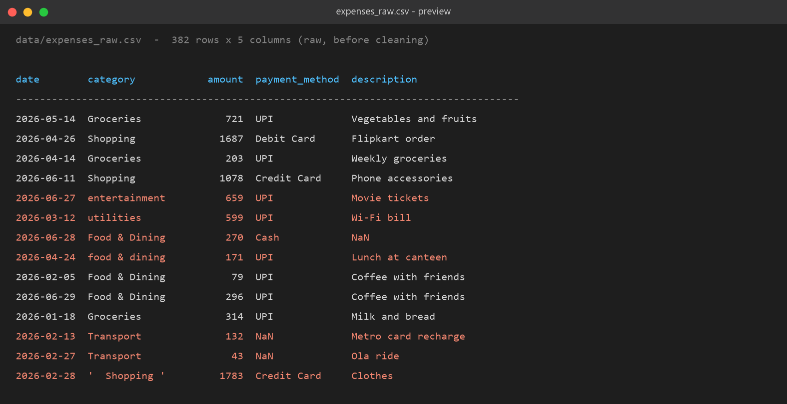
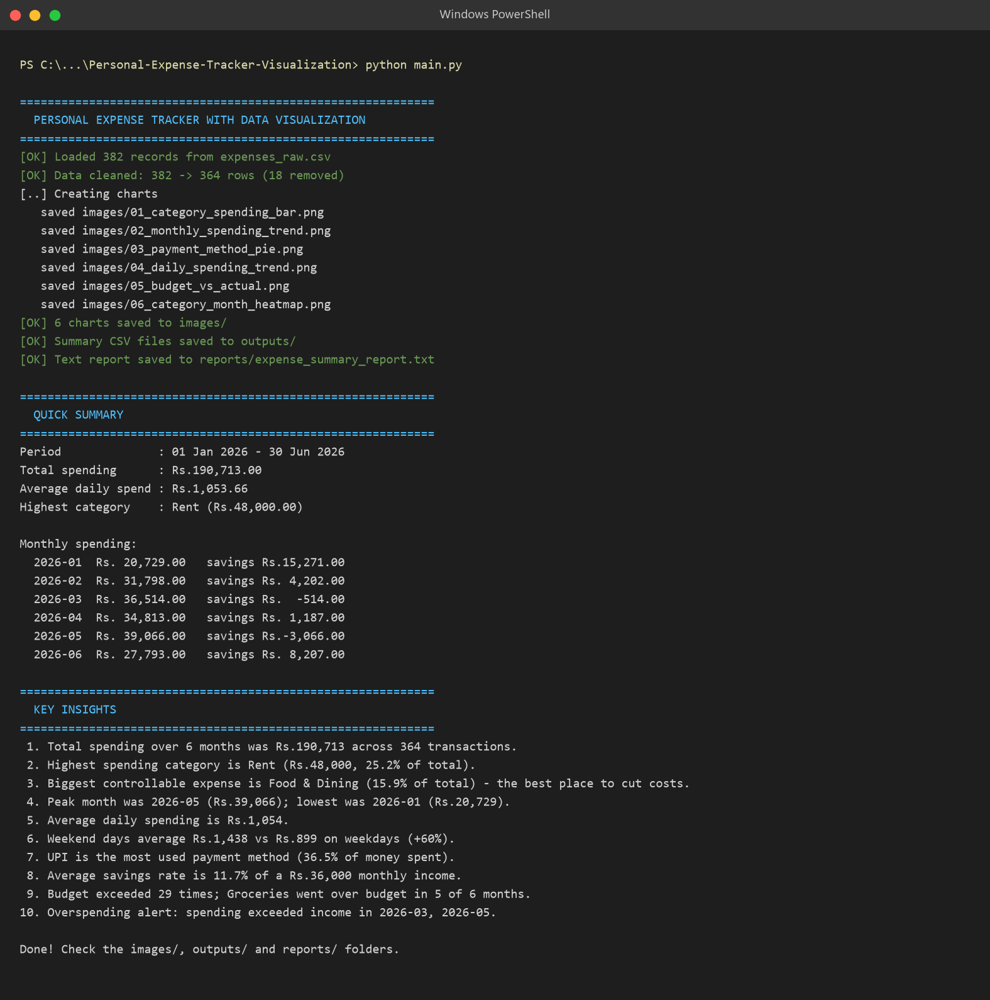
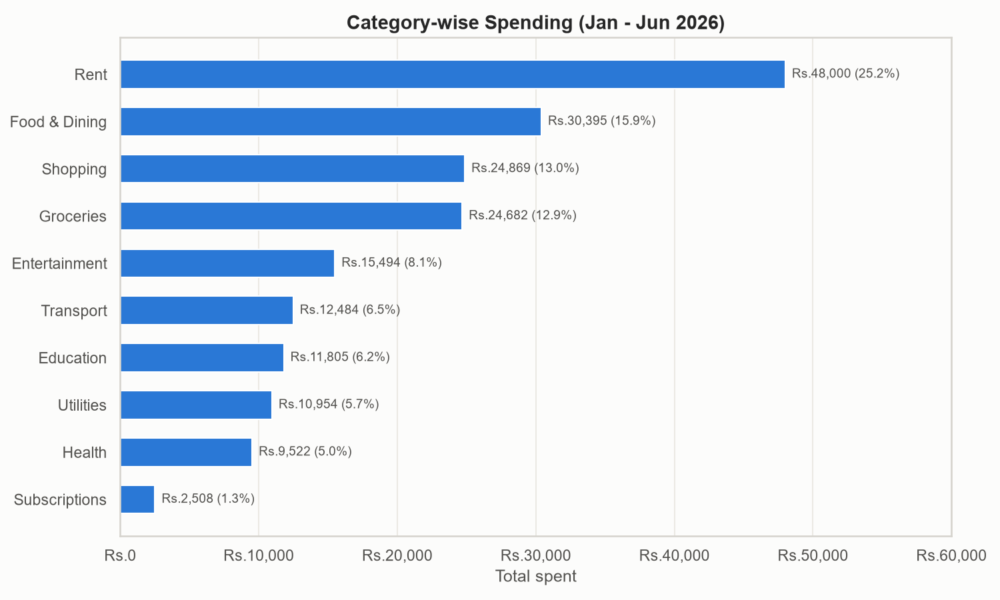
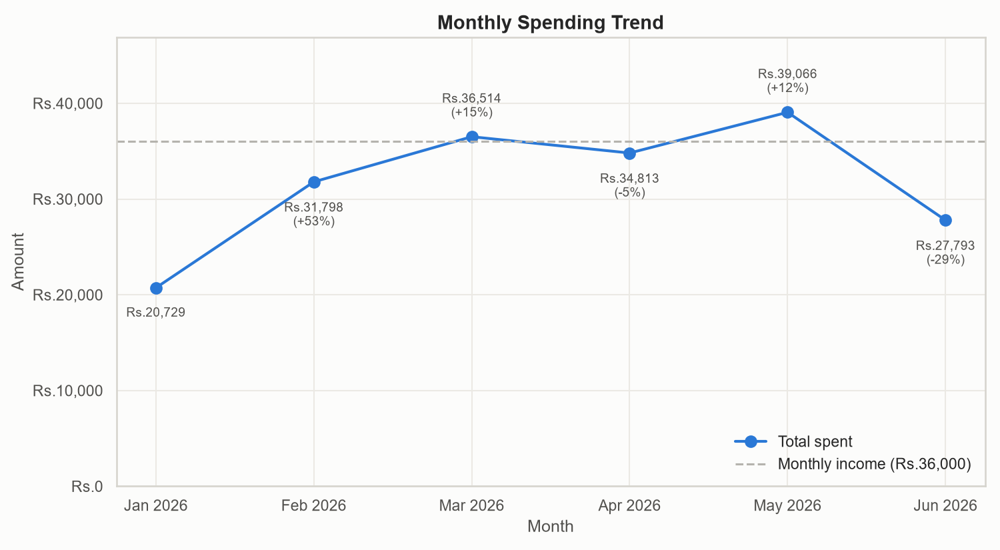
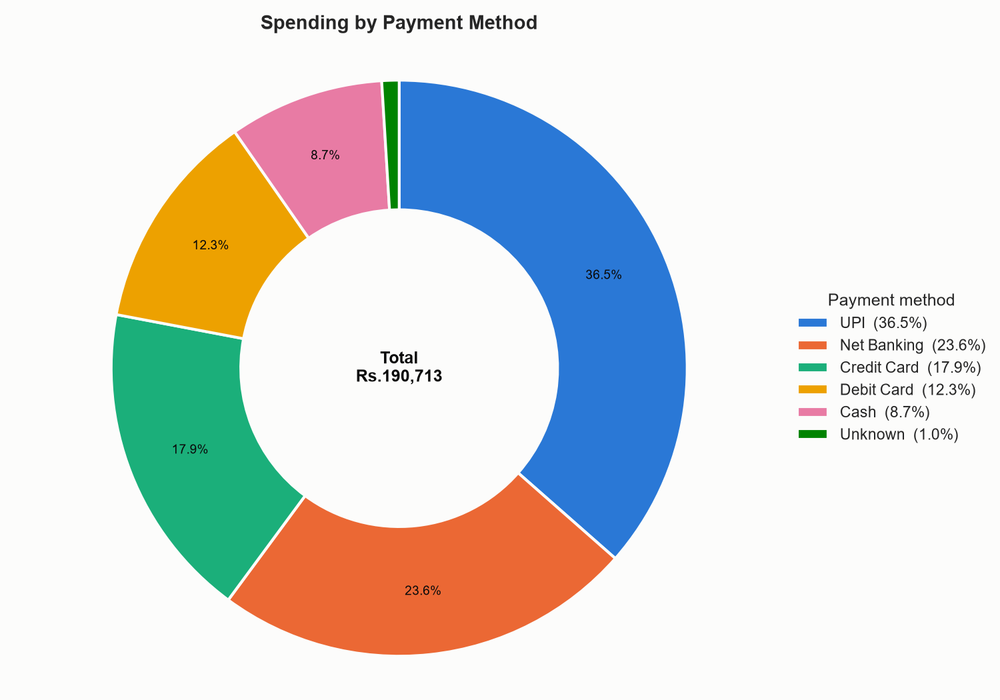
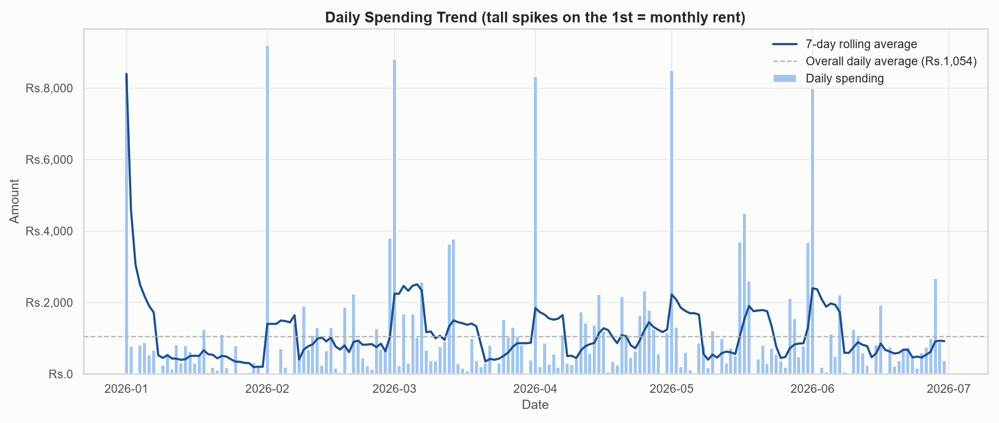
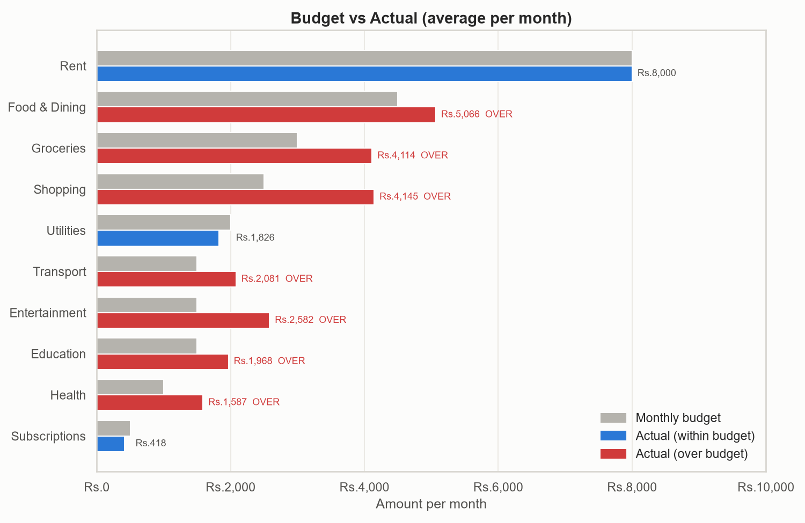
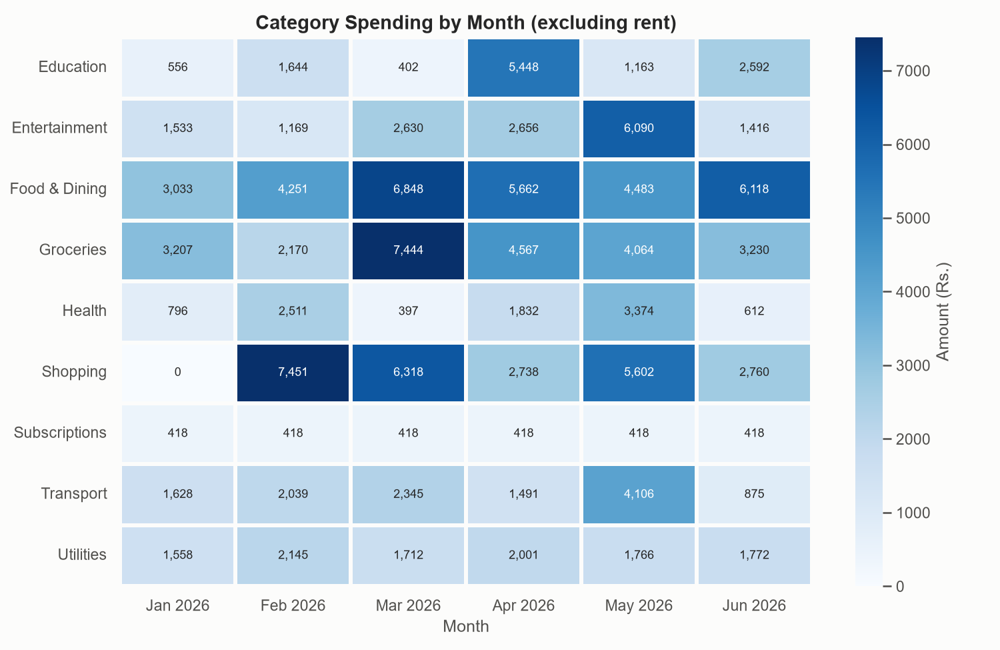

# Personal Expense Tracker with Data Visualization

A Python data-analysis project that turns raw, messy expense records into clean data, budget alerts, six charts, and a plain-English financial report.

    

---

## Project Overview

The project tracks six months (Jan to Jun 2026) of personal expenses for a student or young professional and answers the questions people actually ask about their money:

- Where does my money go? (category-wise analysis)
- Am I spending more month after month? (monthly trend)
- Which payment method do I rely on? (UPI / cards / cash)
- On which days do I overspend? (daily trend, weekday vs weekend)
- Am I staying within budget, and how much do I save? (budget vs actual, savings rate)

No real bank data is used. The dataset is synthetic: realistic, reproducible, and deliberately contains data-quality problems so the cleaning step has real work to do.

## Problem Statement

Most people do not know how much they spend or what they spend it on. Bank apps show individual transactions, not patterns. Without a clear view:

- small daily expenses (food delivery, rides) add up without being noticed
- budgets get exceeded without warning
- savings goals fail

**Goal:** build an automated pipeline that loads expense records, cleans them, analyses spending from several angles, visualizes the results, and produces a summary report with actionable insights.

## Industry Relevance

| Role | What this project demonstrates |
|------|-------------------------------|
| Python Developer | Modular package design, CLI with `argparse`, file I/O, reusable functions |
| Data Analyst | Data cleaning, `groupby`/pivot aggregation, KPIs, trend analysis, insight writing |
| Business Analyst | Budget vs actual (variance analysis), clear reporting, decision-ready insights |
| Automation Engineer | One command runs the whole pipeline: data in, charts and reports out |
| Finance / FinTech | Expense categorisation, savings rate, overspending detection, payment-mode analysis |

The same pipeline pattern (ingest → clean → aggregate → visualize → report) is used for company expense management, MIS reporting, and FinTech apps such as budgeting tools.

## Features

- **Synthetic data generator**: about 380 realistic transactions with seasonality (festival and trip months), weekend effects, and fixed monthly bills
- **Manual entry mode**: `python main.py --add` appends a validated expense to the CSV
- **Data cleaning**: removes duplicates, fixes inconsistent category names, handles `N/A`, negative and missing amounts, invalid dates, and missing payment methods. Every fix is counted in a cleaning log
- **Analysis**: totals, category share, month-over-month change, savings rate, payment-method split, average daily spend, weekday vs weekend, budget vs actual, top expenses
- **Six charts** saved as PNG files
- **Reports**: a text summary report plus seven CSV summary tables
- **Auto-generated insights** in plain English
- **Optional Streamlit dashboard** with filters, and a Jupyter notebook walkthrough

## Tech Stack

| Tool | Purpose |
|------|---------|
| Python 3.10+ | Core language |
| Pandas | Loading, cleaning, grouping, pivoting |
| NumPy | Random synthetic-data generation |
| Matplotlib | Charts |
| Seaborn | Styling and heatmap |
| CSV + `pathlib` + `datetime` | Storage, cross-platform paths, dates |
| Streamlit (optional) | Interactive dashboard |

## Folder Structure

```
Personal-Expense-Tracker-Visualization/
│
├── data/
│   └── expenses_raw.csv            # raw (messy) expense records
├── notebooks/
│   └── expense_exploration.ipynb   # step-by-step exploration
├── src/
│   ├── __init__.py
│   ├── config.py                   # paths, income, budgets, colours
│   ├── data_generator.py           # synthetic dataset creation
│   ├── data_loader.py              # CSV loading + manual entry
│   ├── data_cleaner.py             # cleaning pipeline
│   ├── analyzer.py                 # all calculations + insights
│   ├── visualizer.py               # charts
│   └── report_generator.py         # CSV + text reports
├── outputs/                        # cleaned data + summary CSVs
├── images/                         # generated charts (+ screenshots/)
├── reports/
│   └── expense_summary_report.txt
├── docs/                           # project guide, GitHub guide, interview prep
├── app.py                          # optional Streamlit dashboard
├── main.py                         # run the whole pipeline
├── requirements.txt
├── .gitignore
└── README.md
```

## How to Run

```bash
# 1. Clone
git clone https://github.com/SNischayPrasad/Personal-Expense-Tracker-Visualization.git
cd Personal-Expense-Tracker-Visualization

# 2. Create & activate a virtual environment
python -m venv venv
venv\Scripts\activate          # Windows
source venv/bin/activate       # Mac / Linux

# 3. Install libraries
pip install -r requirements.txt

# 4. Run the full pipeline
python main.py
```

| Command | What it does |
|---------|--------------|
| `python main.py` | Runs the pipeline (creates the dataset first if it does not exist) |
| `python main.py --generate` | Re-creates the synthetic dataset, then runs |
| `python main.py --add` | Adds a manual expense from the terminal, then runs |
| `python -m streamlit run app.py` | Opens the interactive dashboard in a browser |

## Sample Output

```
============================================================
  QUICK SUMMARY
============================================================
Period              : 01 Jan 2026 - 30 Jun 2026
Total spending      : Rs.190,713.00
Average daily spend : Rs.1,053.66
Highest category    : Rent (Rs.48,000.00)

============================================================
  KEY INSIGHTS
============================================================
 1. Total spending over 6 months was Rs.190,713 across 364 transactions.
 2. Highest spending category is Rent (Rs.48,000, 25.2% of total).
 3. Biggest controllable expense is Food & Dining (15.9% of total) - the best place to cut costs.
 4. Peak month was 2026-05 (Rs.39,066); lowest was 2026-01 (Rs.20,729).
 5. Average daily spending is Rs.1,054.
 6. Weekend days average Rs.1,438 vs Rs.899 on weekdays (+60%).
 7. UPI is the most used payment method (36.5% of money spent).
 8. Average savings rate is 11.7% of a Rs.36,000 monthly income.
 9. Budget exceeded 29 times; Groceries went over budget in 5 of 6 months.
10. Overspending alert: spending exceeded income in 2026-03, 2026-05.
```

Full report: [`reports/expense_summary_report.txt`](reports/expense_summary_report.txt)

**Data cleaning results:** 382 raw rows became 364 clean rows. The cleaner removed 6 duplicates, 10 invalid amounts and 2 invalid dates, fixed 18 category names, and filled 5 missing payment methods.

## Screenshots

### Raw Dataset (before cleaning, problem rows in red)


### Terminal Output


### Category-wise Spending


### Monthly Spending Trend


### Payment Method Split


### Daily Spending Trend


### Budget vs Actual


### Category × Month Heatmap


## Key Insights (from the sample data)

1. **Rent is the largest expense, but it is fixed.** The real lever is Food & Dining, the largest controllable category.
2. **Weekends cost 60% more per day** than weekdays, mostly from outings and food delivery.
3. **March (Holi festival) and May (Goa trip and sales) pushed spending above income.** Planning a sinking fund for these months would prevent the deficit.
4. **Groceries exceeded budget in 5 of 6 months**, so either the budget is unrealistic or grocery shopping needs a list.
5. **UPI handles over a third of all money spent**, which makes UPI history the best source for future automatic tracking.

## Learning Outcomes

- Structuring a Python project as a reusable package (`src/`) with a single entry point
- Real-world data cleaning with Pandas: duplicates, type coercion, missing values, text normalisation, date parsing
- Aggregation with `groupby`, `pivot_table`, `pct_change` and `rolling`
- Choosing the right chart for each question and making it readable
- Turning numbers into business insights and automated reports
- Version control and documenting a project for GitHub

## Future Improvements

- Import real bank / UPI statement CSVs (column mapping)
- Automatic category prediction from the description (keyword rules, then ML)
- SQLite database instead of CSV
- Email or PDF monthly report
- Spending forecast for next month (moving average or linear regression)

## Author

**Sadhanala Nischay Prasad** · [LinkedIn](https://linkedin.com/in/your-profile) · [GitHub](https://github.com/SNischayPrasad)

*This project uses synthetic data for learning purposes. No real financial data is included.*
